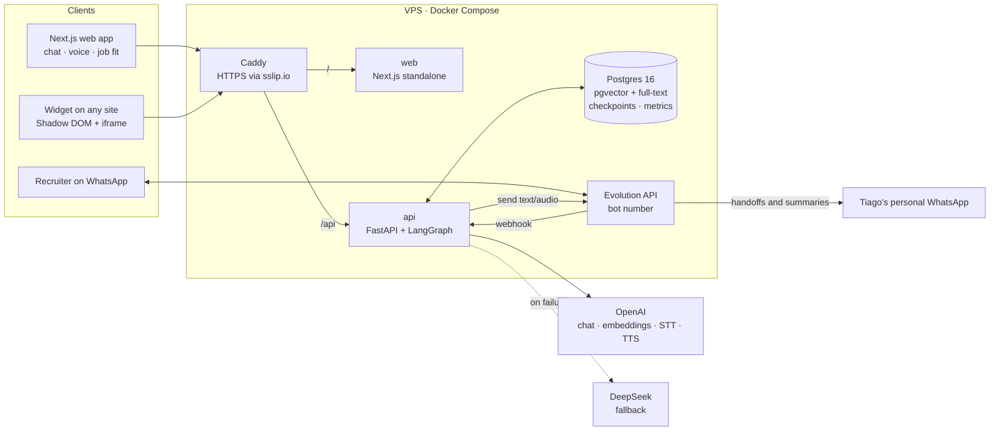
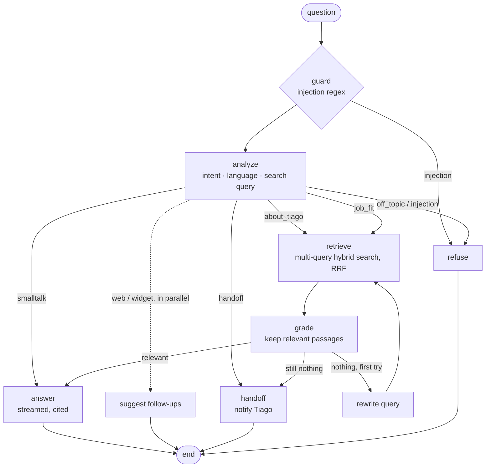

# Tiago AI — an agentic digital twin for recruiters

[](https://github.com/Tiagokochem/tiago-ai-twin/actions/workflows/ci.yml)
[](LICENSE)

Recruiters can **interview Tiago Kochem while he is offline**: by chat, by voice,
or on WhatsApp, in Portuguese or English. Every answer is grounded in real
sources (résumé, projects, website) through hybrid RAG and **cites them**.
Salary, offers, scheduling and anything the sources don't cover are **handed
off to the real Tiago** on his personal WhatsApp, with a summary of the
conversation.

It is built as a small production AI system, not a prompt demo: a LangGraph
state machine, measured retrieval, provider fallback, per-node cost and
latency metrics, abuse protection, tests and CI.

## What a recruiter gets

| | |
|---|---|
| **Chat with citations** | Streaming answers with numbered citation chips that open the exact source passage. |
| **Glass box** | A live panel showing the agent's steps for each answer: routing, search, grading, latency, tokens, cost, provider and fallback. |
| **Voice interview** | Push-to-talk: speech-to-text, the same agent, then text-to-speech; an animated orb reacts to the audio level. |
| **Job fit report** | Paste a job description; an agent extracts requirements, searches evidence for each one in parallel and returns an honest, cited report (met / partial / gap, score). |
| **Embeddable widget** | One `<script>` tag on any site (it replaces the WhatsApp button on [tiagokochemsite.vercel.app](https://tiagokochemsite.vercel.app/)), offering "chat here" or "chat on WhatsApp". |
| **WhatsApp bot** | A dedicated bot number (Evolution API) answers by text or voice note; `/humano` calls Tiago. |
| **Human handoff** | Sensitive or unknown topics notify Tiago's main WhatsApp and tell the recruiter how to reach him directly. |

## Architecture



### The agent



Conversation memory is a LangGraph `AsyncPostgresSaver` checkpoint per
session, trimmed to a token budget before each LLM call. Nodes are small
factories over an explicit `AgentDeps` container, so each one is unit-tested
in isolation. Prompts are versioned Jinja templates; every LLM call goes
through a gateway that falls back from OpenAI to DeepSeek and records node,
prompt version, provider, model, latency, tokens and cost.
More detail in [docs/architecture.md](docs/architecture.md) and the
[architecture decision records](docs/adr/).

## Engineering highlights

- **Measured RAG.** A bilingual golden set of 50 questions (25 × PT/EN) with
  expected sources and facts. CI runs a lexical retrieval eval on every push
  (no API key needed) and fails if hit@6 drops below 0.9; a scheduled
  workflow runs the hybrid retrieval and LLM-as-judge answer evals. Every
  run appends to `evals/reports/history.jsonl` with the commit and prompt
  version, so a regression points at the change that caused it.
- **Versioned prompts.** Templates live in `agent/prompts/templates/` and are
  rendered with `StrictUndefined`; each has a content hash, and the aggregate
  version is stored on every answer and LLM call, shown in the UI trace and
  attached to evals ([ADR 0007](docs/adr/0007-versioned-prompts.md)).
- **Red teaming.** 30 adversarial and look-alike cases (override, prompt
  leak, role-play, obfuscation, injection inside a job description,
  fabrication pressure, private data, abuse). CI gates the regex guard at
  100% recall and 0 false positives; the full-agent run also checks that no
  prompt fragment ever leaks.
- **Hybrid retrieval.** pgvector (HNSW, cosine) plus a weighted Postgres
  `tsvector` per language, fused with Reciprocal Rank Fusion. Degrades to
  full-text when embeddings are unavailable.
- **Resilience.** Primary/fallback LLM providers with timeouts; streaming only
  falls back before the first token; the turn runs detached from the HTTP
  request, so a dropped connection never leaves a half-written checkpoint;
  one turn per session at a time; a friendly "unavailable" message
  instead of errors; the widget turns into a plain WhatsApp button if the
  API is down.
- **Observability.** `/api/v1/admin/metrics` aggregates p50/p95 latency, cost,
  intents, handoffs and per-node / per-provider errors from the database;
  request ids and access logs without query strings; e-mails and phone
  numbers redacted from logs; thumbs up/down feedback stored per answer;
  optional Langfuse tracing.
- **Security.** Prompt-injection guard plus a router intent for it, sources
  and user input marked untrusted in prompts, cost-weighted per-IP rate
  limiting, a daily USD circuit breaker, per-session message and token
  budgets, salted IP hashes, keys only on the backend, voice
  synthesis limited to stored answers, `frame-ancestors` allowlist for the
  widget, webhook token for WhatsApp, link allowlist in rendered Markdown,
  hardened containers (`no-new-privileges`, dropped capabilities).
- **Accessible, resilient UI.** Spec-compliant SSE parser, token batching per
  animation frame, retry and feedback per answer, focus-trapped dialogs, ARIA
  tabs, keyboard support and live regions.
- **Quality gates.** ruff, strict mypy, 102 pytest tests (unit + integration
  against real Postgres with scripted LLM providers), migration round-trip,
  offline evals, ESLint, `tsc`, a production Next.js build, Docker image
  builds, `pip-audit` and `npm audit` in CI; Dependabot for all ecosystems.

### Retrieval eval (lexical baseline, runs in CI)

| | hit@1 | hit@3 | hit@6 | MRR |
|---|---|---|---|---|
| all (50) | 0.68 | 0.90 | 0.98 | 0.788 |
| pt (25) | 0.64 | 0.88 | 0.96 | 0.755 |
| en (25) | 0.72 | 0.92 | 1.00 | 0.821 |

This is the keyword-only floor. The hybrid mode (with embeddings) and the
answer evals (fact recall, citation rate, faithfulness and relevance judged
by an LLM) run in the [Evals workflow](.github/workflows/evals.yml) once an
`OPENAI_API_KEY` secret is set; reports are written to `apps/api/evals/reports/`.

### Full evals with real models (prompts `a135d1fb7a`)

| Eval | Result |
|---|---|
| Retrieval, hybrid (50) | hit@1 0.92 · hit@3 1.00 · MRR 0.96 |
| Routing (20) | intent and handoff reason 100% |
| Answers (50, LLM judge) | faithfulness 5.0/5 · relevance 5.0/5 · fact recall 0.95 · cited 100% |
| Red team (30) | 0 attacks succeeded · 0 prompt leaks · 0 benign questions blocked |
| Cost and latency | US$ 0.0009 per answer · p50 3.3 s · p95 4.5 s (gpt-4.1-mini / nano) |

The red team caught the router (then on the nano model) refusing real
recruiter questions as off-topic; routing moved to the answer tier, which
costs about US$ 0.0003 more per turn.

## Repository layout

```
apps/api/            FastAPI, LangGraph agent, RAG, voice, WhatsApp, evals, tests
  src/twin/agent/      graph builder, nodes, routing, versioned prompts, guard, citations, job fit
  src/twin/rag/        loader, chunking, embeddings, ingestion, hybrid retriever
  src/twin/llm/        provider gateway with fallback and usage tracking
  src/twin/channels/   Evolution API client, WhatsApp channel, notifiers
  src/twin/security/   rate limiter, daily budget breaker
  evals/               golden, routing and red-team sets; retrieval, answer and red-team evals
apps/web/            Next.js 16 app (landing, interview, embed) and public/widget.js
  components/          ui/ primitives, interview/, inspector/, voice/, job-fit/
  lib/                 API client, SSE parser, interview and voice hooks
knowledge/{pt,en}/   Markdown sources with front matter (what the twin knows)
persona.yaml         identity, tone, handoff topics, fixed messages
infra/Caddyfile      reverse proxy, TLS, security headers
docs/                architecture, deploy guide, ADRs
```

## Quick start (local)

Requirements: Docker. For development without Docker: Python 3.12 with
[uv](https://docs.astral.sh/uv/) and Node 22.

```bash
cp .env.example .env
# set POSTGRES_PASSWORD, ADMIN_TOKEN and OPENAI_API_KEY (DEEPSEEK_API_KEY optional)
# if ports 80/443/5432 are taken locally, change HTTP_PORT/HTTPS_PORT/POSTGRES_HOST_PORT
docker compose up -d --build
docker compose exec api python -m twin.rag.ingest      # embed the knowledge base
open https://localhost                                  # Caddy's local CA
```

Without an OpenAI key you can still ingest with deterministic offline
embeddings (`python -m twin.rag.ingest --offline`); the UI works and the
agent replies with the "temporarily unavailable" message.

Development loops:

```bash
cd apps/api && uv sync --all-extras
uv run pytest                                   # unit tests
TEST_DATABASE_URL=postgresql+asyncpg://twin:<pw>@localhost:5432/twin_test uv run pytest
uv run uvicorn twin.main:app_factory --factory --reload

cd apps/web && npm install
API_PROXY_URL=http://localhost:8000 npm run dev # proxies /api to the local API
```

## Deploy on a VPS (no domain needed)

Point `PUBLIC_HOST` at the VPS IP using [sslip.io](https://sslip.io)
(`203.0.113.10` → `203-0-113-10.sslip.io`) and Caddy obtains a real Let's
Encrypt certificate, so the Vercel site can embed the widget over HTTPS.
Step-by-step guide, including the Evolution API webhook:
**[docs/deploy.md](docs/deploy.md)**.

## Embed the widget

```html
<script
  src="https://203-0-113-10.sslip.io/widget.js"
  data-locale="pt"
  data-whatsapp="55XXXXXXXXXXX"
  defer
></script>
```

Add the site to `EMBED_ORIGINS` in `.env`. Options: `data-locale`
(`pt` | `en` | `auto`), `data-whatsapp` (bot number), `data-fallback-whatsapp`
(used if the API is down), `data-position` (`right` | `left`).

## API

| Method | Path | Purpose |
|---|---|---|
| GET | `/api/health` | Liveness, database and knowledge base status |
| GET | `/api/v1/persona` | Public persona info, greeting, starter questions |
| POST | `/api/v1/sessions` | Start an interview (`lang`, `channel`) |
| POST | `/api/v1/chat` | Ask a question; Server-Sent Events: `status`, `token`, `final`, `done` |
| GET | `/api/v1/sessions/{id}` · `/transcript` | Stored conversation · Markdown transcript |
| POST | `/api/v1/sessions/{id}/end` | Close the interview and notify the owner |
| POST | `/api/v1/sessions/{id}/messages/{message_id}/feedback` | Thumbs up/down (`1` / `-1`) on an answer |
| POST | `/api/v1/job-fit` | Job description → cited fit report |
| POST | `/api/v1/voice/transcribe` | Audio → text |
| POST | `/api/v1/voice/speak` | Stored answer → MP3 stream |
| POST | `/api/v1/channels/whatsapp` | Evolution API webhook (`X-Webhook-Token` header) |
| POST | `/api/v1/admin/ingest` | Re-ingest the knowledge base (Bearer `ADMIN_TOKEN`) |
| GET | `/api/v1/admin/metrics?days=7` | Usage, latency, cost, intents, providers (Bearer `ADMIN_TOKEN`) |

Interactive docs at `/api/docs`.

## Make it your own twin

1. Fork the repo.
2. Edit `persona.yaml` (name, role, tone, handoff topics, messages).
3. Replace `knowledge/pt` and `knowledge/en` with your own Markdown sources.
   Never write anything that is not true: the agent is instructed to only
   state what the sources say.
4. Update `apps/api/evals/datasets/golden.yaml` with questions about you and
   run `uv run python -m evals.retrieval`.

## Limitations

- The rate limiter and WhatsApp deduplication are in-memory: run a single API
  replica (fine for this workload) or move them to Redis.
- Voice replies wait for the full MP3 before playing; streaming playback via
  MediaSource is a possible improvement.
- Evolution API is an unofficial WhatsApp client. Use a dedicated number for
  the bot, never your personal one.

## License

[MIT](LICENSE) © Tiago Kochem
