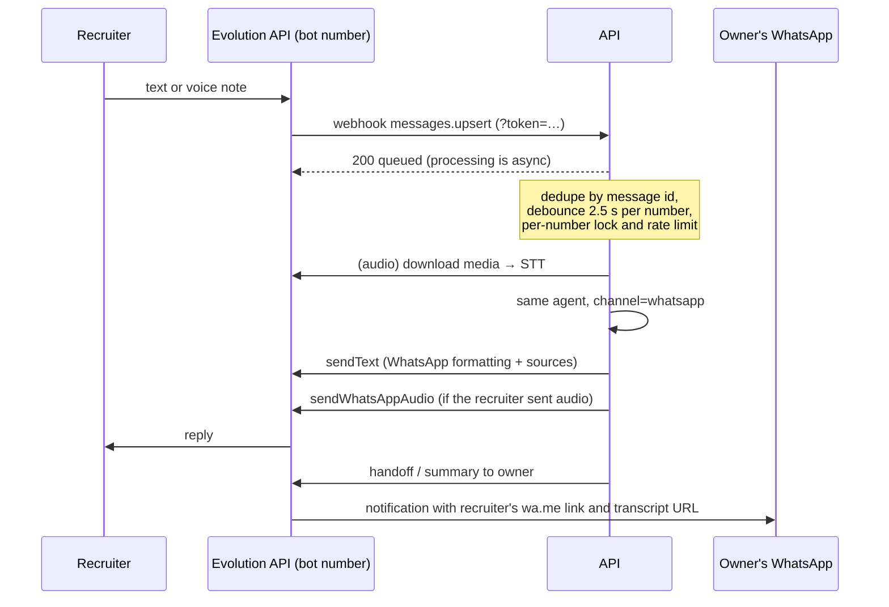

# Architecture

## Components

| Component | Tech | Responsibility |
|---|---|---|
| `caddy` | Caddy 2 | TLS (Let's Encrypt via sslip.io), routes `/api/*` to the API (prefix stripped, SSE unbuffered) and everything else to the web app; security headers and the widget `frame-ancestors` allowlist. |
| `web` | Next.js 16 (standalone) | Landing page, interview UI (`/[lang]/interview`), iframe target for the widget (`/[lang]/embed`), and `widget.js`. Talks to the API only through same-origin `/api`. |
| `api` | FastAPI, LangGraph, SQLAlchemy | Sessions, streaming chat, job fit, voice, WhatsApp webhook, admin (ingestion, metrics). |
| `postgres` | Postgres 16 + pgvector | Knowledge chunks (embeddings + `tsvector`), chat sessions and messages, per-call LLM metrics, LangGraph checkpoints. |
| Evolution API | external | WhatsApp gateway for the bot number. |

## Request flow: one chat turn

1. `POST /v1/chat` with `session_id` and `message`. The rate limiter and the
   per-session budget (messages, tokens) are checked; the user message is stored.
2. The LangGraph graph runs with `thread_id = session_id`, so the checkpointer
   restores the conversation history.
3. Nodes emit custom stream events (`status`, `token`) through
   `get_stream_writer`; the service forwards them as Server-Sent Events.
4. After the graph finishes, the service emits `final` (intent, citations,
   follow-ups, handoff) and persists the assistant message together with one
   row per LLM call (node, provider, model, latency, tokens, cost, fallback, error).
5. `done` carries the turn's latency, token count, cost and providers; the
   UI's glass box renders it.
6. If a handoff happened, the notifier runs in the background (WhatsApp to the
   owner, or a log line when WhatsApp is not configured).

## Agent nodes

| Node | Model tier | What it does |
|---|---|---|
| `guard` | none | Regex check (PT/EN, accent-insensitive) for prompt injection. |
| `analyze` | fast | Structured output: intent, language, standalone search query, handoff reason. |
| `retrieve` | embeddings | Hybrid search filtered by language; job descriptions use a larger `top_k`. |
| `grade` | fast | Keeps only passages useful for the question (skipped for job fit). |
| `rewrite` | fast | One alternative query when nothing relevant was found. |
| `answer` | answer | Streams a cited answer; invalid `[n]` markers are stripped; citations are extracted. |
| `followups` | fast | Three suggested next questions (web and widget only). |
| `handoff` | none | Fixed message with the owner's contact; marks the turn for notification. |
| `refuse` | none | Off-topic or injection message. |

## Retrieval

- **Chunking:** by Markdown heading, then by paragraph up to 1,200 characters;
  the embedded text is prefixed with `Title > Heading`.
- **Indexes:** HNSW (cosine) on the embedding; GIN on a `tsvector` built with
  the language's text search configuration, title/heading weighted `A`,
  content `B`.
- **Query:** vector top-k and full-text top-k (OR semantics over stemmed
  terms) fused with Reciprocal Rank Fusion (`k = 60`).
- **Ingestion** is incremental: a content hash (including chunking version and
  embedding model) decides what to re-embed.

## Job fit

A separate two-step agent (`JobFitService`): the fast model extracts the role
and up to eight requirements; each requirement is searched in parallel; the
results are interleaved round-robin (so every requirement gets evidence) and
deduplicated; the answer model returns a structured assessment with citations.

## Voice

- Browser: `MediaRecorder` (WebM/Opus or MP4 on Safari) with an `AnalyserNode`
  driving the orb.
- `POST /v1/voice/transcribe` → OpenAI `gpt-4o-mini-transcribe` with a domain
  hint (names and technologies).
- The text goes through the normal chat endpoint (same agent, same trace).
- `POST /v1/voice/speak` takes a `session_id` + `message_id`, loads the stored
  answer, strips Markdown and citations, and streams MP3 from
  `gpt-4o-mini-tts`. Arbitrary text cannot be synthesized.

## WhatsApp

## Data model

- `documents`, `chunks` — knowledge base.
- `chat_sessions` — channel, language, external id (WhatsApp number), totals,
  `handoff_at`, `ended_at`, `last_activity_at`.
- `chat_messages` — role, content, intent, citations, follow-ups, handoff
  reason, degraded flag, latency.
- `llm_calls` — one row per provider attempt, linked to the assistant message.
- LangGraph checkpoint tables (created by `AsyncPostgresSaver.setup()`).

## Security notes

- LLM, Evolution and admin secrets live only in the API container.
- Untrusted text (user input, sources, job descriptions) is never allowed to
  change instructions; the guard and the router both detect injection.
- Rate limits per salted IP hash and per WhatsApp number; per-session message
  and token budgets.
- The transcript endpoint is addressed by an unguessable session UUID.
- Only `/[lang]/embed` may be framed, and only by `EMBED_ORIGINS`.
