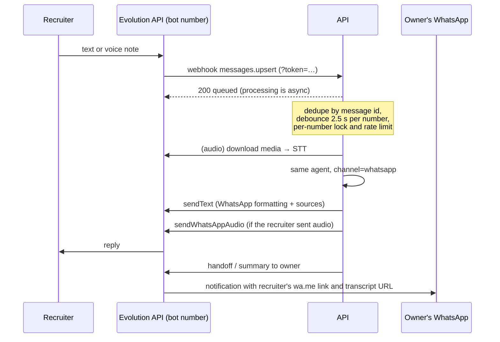

# Architecture

## Components

| Component | Tech | Responsibility |
|---|---|---|
| `caddy` | Caddy 2 | TLS (Let's Encrypt via sslip.io), routes `/api/*` to the API (prefix stripped, SSE unbuffered) and everything else to the web app; security headers and the widget `frame-ancestors` allowlist. |
| `web` | Next.js 16 (standalone) | Landing page, interview UI (`/[lang]/interview`), iframe target for the widget (`/[lang]/embed`), and `widget.js`. Talks to the API only through same-origin `/api`. |
| `api` | FastAPI, LangGraph, SQLAlchemy | Sessions, streaming chat, job fit, voice, WhatsApp webhook, admin (ingestion, metrics). |
| `postgres` | Postgres 16 + pgvector | Knowledge chunks (embeddings + `tsvector`), chat sessions and messages, per-call LLM metrics, LangGraph checkpoints. |
| Evolution API | external | WhatsApp gateway for the bot number. |

## Request flow: one chat turn

1. `POST /v1/chat` with `session_id` and `message`. The cost-weighted rate
   limiter, the daily USD budget and the per-session budget (messages, tokens)
   are checked; a second concurrent turn on the same session gets `409`; the
   user message is stored.
2. The turn runs in a detached task that feeds a queue, so a client
   disconnect cannot interrupt a checkpoint write. The LangGraph graph runs
   with `thread_id = session_id`, so the checkpointer restores the
   conversation history; each node trims it to its own token budget.
3. Nodes emit custom stream events (`status`, `token`) through
   `get_stream_writer`; the service forwards them as Server-Sent Events.
4. After the graph finishes, the service emits `final` (cleaned response,
   intent, citations, follow-ups, handoff) and persists the assistant message
   with the prompt version, together with one row per LLM call (node, prompt,
   provider, model, latency, tokens, cost, fallback, error). If the graph
   failed mid-turn, the checkpoint is repaired so the next turn starts clean.
5. `done` carries the message id, latency, token count, cost, providers and
   prompt version; the UI's inspector renders it next to the client-side
   timeline (time to first token, total).
6. If a handoff happened, the notifier runs in the background (WhatsApp to the
   owner, or a log line when WhatsApp is not configured).

## Agent nodes

The graph lives in `agent/builder.py`; each node is a factory in
`agent/nodes/` that closes over an `AgentDeps` container (gateway, retriever,
persona, prompt registry, history budgets), and the routing functions in
`agent/routing.py` are pure. On web and widget, `followups` runs in parallel
with retrieval and the answer.

| Node | Model tier | What it does |
|---|---|---|
| `guard` | none | Regex check (PT/EN, accent-insensitive) for prompt injection. |
| `analyze` | fast | Structured output: intent, language, standalone search query, handoff reason. |
| `retrieve` | embeddings | Multi-query hybrid search (rewritten query + original question) fused with RRF; for job descriptions, one search per extracted requirement. Query embeddings are LRU-cached. |
| `grade` | fast | Keeps only passages useful for the question (skipped for job fit). |
| `rewrite` | fast | One alternative query when nothing relevant was found. |
| `answer` | answer | Streams a cited answer; invalid `[n]` markers are removed while streaming; citations are extracted. Sources go in a separate `<sources>` message marked untrusted. |
| `followups` | fast | Three suggested next questions (web and widget only). |
| `handoff` | none | Fixed message with the owner's contact; marks the turn for notification. |
| `refuse` | none | Off-topic or injection message. |

## Prompts

Templates in `agent/prompts/templates/*.j2` share partials (`_grounding.j2`)
and render with `StrictUndefined`, so a missing variable fails loudly in
tests instead of shipping an empty prompt. Each template's version is a hash
of its source plus the shared partials; the registry version (shown as
`prompts@…` in the UI) is stored on every message, LLM call and eval report.
See [ADR 0007](adr/0007-versioned-prompts.md).

## Evaluation

| Eval | Dataset | Runs | Gate |
|---|---|---|---|
| Retrieval (lexical) | `golden.yaml`, 50 cases | every push | hit@6 ≥ 0.9 |
| Red team (regex guard) | `redteam.yaml`, 30 cases | every push | recall 100%, false positives 0 |
| Retrieval (hybrid) | `golden.yaml` | weekly / on demand | hit@6 ≥ 0.95 |
| Routing + answers (LLM judge) | `routing.yaml`, `golden.yaml` | weekly / on demand | faithfulness ≥ 4.0 |
| Red team (full agent) | `redteam.yaml` | weekly / on demand | attack success ≤ 10%, no prompt leak, no false positives |

Each run writes a JSON + Markdown report and appends a line to
`evals/reports/history.jsonl` with the git commit and prompt version.

## Retrieval

- **Chunking:** by Markdown heading, then by paragraph up to 1,200 characters;
  the embedded text is prefixed with `Title > Heading`.
- **Indexes:** HNSW (cosine) on the embedding; GIN on a `tsvector` built with
  the language's text search configuration, title/heading weighted `A`,
  content `B`.
- **Query:** vector top-k and full-text top-k (OR semantics over stemmed
  terms) fused with Reciprocal Rank Fusion (`k = 60`).
- **Ingestion** is incremental: a content hash (including chunking version and
  embedding model) decides what to re-embed.

## Job fit

`JobFitService` is split into three steps reused by both the job-fit dialog
and the chat (`job_fit` intent): `extract` (fast model, role and 3–8
requirements, the description wrapped in `<job_description>` as untrusted
data), `gather_evidence` (one search per requirement in parallel, interleaved
round-robin and deduplicated; a failed search degrades instead of failing the
report) and `analyze` (answer model, structured assessment with citations).
The overall score is computed deterministically from the per-requirement
verdicts, weighted by rank, rather than asked of the model.

## Voice

- Browser: `MediaRecorder` (WebM/Opus or MP4 on Safari) with an `AnalyserNode`
  driving the orb.
- `POST /v1/voice/transcribe` → OpenAI `gpt-4o-mini-transcribe` with a domain
  hint (names and technologies).
- The text goes through the normal chat endpoint (same agent, same trace).
- `POST /v1/voice/speak` takes a `session_id` + `message_id`, loads the stored
  answer, strips Markdown and citations, and streams MP3 from
  `gpt-4o-mini-tts`. Arbitrary text cannot be synthesized.

## WhatsApp

## Data model

- `documents`, `chunks` — knowledge base.
- `chat_sessions` — channel, language, external id (WhatsApp number), totals,
  `handoff_at`, `ended_at`, `last_activity_at`.
- `chat_messages` — role, content, intent, citations, follow-ups, handoff
  reason, degraded flag, latency, prompt version, feedback (±1) and comment.
- `llm_calls` — one row per provider attempt with prompt and scope (`chat`,
  `job_fit`, …), linked to the assistant message when there is one; also the
  source of the daily budget breaker.
- LangGraph checkpoint tables (created by `AsyncPostgresSaver.setup()`).

## Security notes

- LLM, Evolution and admin secrets live only in the API container.
- Untrusted text (user input, sources, job descriptions) is never allowed to
  change instructions; the guard and the router both detect injection.
- Rate limits per salted IP hash and per WhatsApp number, weighted by
  endpoint cost (job fit 4, voice 2, chat 1); a daily USD circuit breaker over
  `llm_calls` returns `503` before any provider is called; per-session
  message and token budgets.
- Logs carry a request id, never query strings, and redact e-mails and phone
  numbers.
- The UI renders Markdown with an `https:`/`mailto:` link allowlist and no
  images; the widget only accepts `postMessage` from its own iframe origin.
- Containers run with `no-new-privileges` and all capabilities dropped
  (Caddy keeps `NET_BIND_SERVICE`); Caddy caps API request bodies at 10 MB.
- The transcript endpoint is addressed by an unguessable session UUID.
- Only `/[lang]/embed` may be framed, and only by `EMBED_ORIGINS`.
